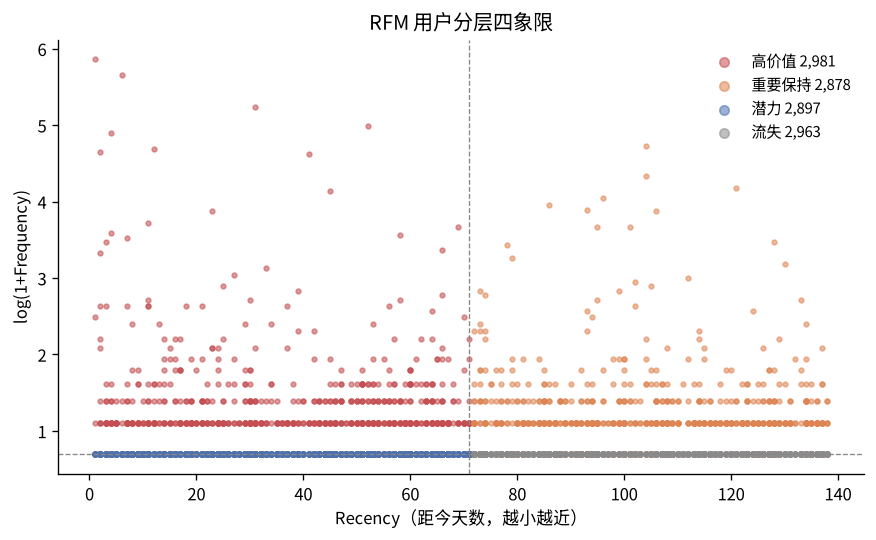
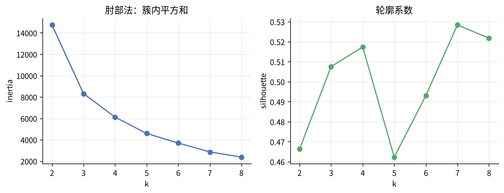
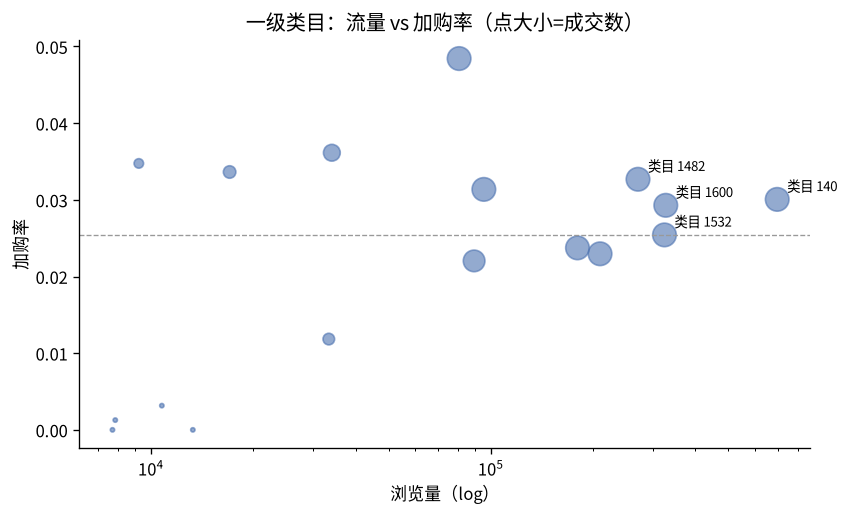
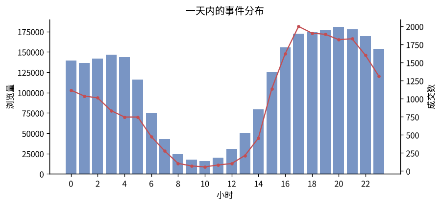

# 📊 电商用户行为分析 · E-commerce User Behavior Analysis

基于 Retailrocket 真实行为日志（2,755,641 条事件、140 万访客、4.5 个月），
完成**转化漏斗、时间趋势、RFM 分层、订单集中度、K-Means 聚类、品类维度、时段分布、留存**八块分析。

| 指标 | 数值 |
|---|---|
| 原始事件 | 2,756,101 条 |
| 去重后 | 2,755,641 条（重复 460 条） |
| 独立访客 | 1,407,580 |
| 独立商品 | 235,061 |
| 时间范围 | 2015-05-03 ~ 2015-09-18 |


---

## 📦 数据来源

- **数据集**：Retailrocket recommender system dataset（Kaggle，作者 Roman Zykov）
- **地址**：https://www.kaggle.com/datasets/retailrocket/ecommerce-dataset
- **许可**：CC BY-NC-SA 4.0 —— 需署名、仅限非商业用途、衍生作品相同方式共享

| 文件 | 用途 |
|---|---|
| `events.csv` | 行为日志（主分析） |
| `item_properties_part1/2.csv` | 商品属性，用于提取 `categoryid` |
| `category_tree.csv` | 类目树，用于上卷到一级类目 |

| 字段 | 含义 |
|---|---|
| timestamp | Unix 毫秒时间戳 |
| visitorid | 访客 ID（已哈希） |
| event | view / addtocart / transaction |
| itemid | 商品 ID（已哈希） |
| transactionid | 订单 ID，仅成交事件有值 |

---

## 一、转化漏斗：事件级 vs 用户级

| 环节 | 事件数 | 事件级环节转化 | 用户数 | 用户级环节转化 |
|---|---|---|---|---|
| 浏览 | 2,664,218 | — | 1,404,179 | — |
| 加购 | 68,966 | 2.59% | 37,722 | 2.69% |
| 成交 | 22,457 | 32.56% | 11,719 | 31.07% |

整体浏览→成交：事件级 **0.84%**，用户级 **0.83%**。

两种口径几乎一致，说明同一用户在同一环节平均只产生约 1 个事件，结论稳健：
**瓶颈在「浏览 → 加购」（约 2.6%）**，加购→成交（约 32%）属正常水平。
优化重点应放在商品详情页说服力与推荐精准度，而不是支付环节。

---

## 二、时间趋势


- 日均活跃访客 11,867 人，峰值 17,516（2015-07-26）
- 日均成交 162 笔，峰值 276 笔（2015-06-16）

---

## 三、RFM 分层

11,719 名成交用户，R、F 各按四分位打分（4→1）：

| 分层 | 人数 | 占比 |
|---|---|---|
| 高价值 | 2,981 | 25.4% |
| 流失 | 2,963 | 25.3% |
| 潜力 | 2,897 | 24.7% |
| 重要保持 | 2,878 | 24.6% |



> ⚠️ **口径说明**：四分位打分会让四类人数天然接近 25%，这是**打分方法的产物，不是业务结论**。
> 真实的不均衡体现在订单集中度（下节）。若要得到业务阈值，应改用 R/F 原始值或经验切分。

---

## 四、订单集中度：少数人贡献多数订单


| 用户占比（按订单数降序） | 订单占比 |
|---|---|
| 前 1% | 27.8% |
| 前 5% | 39.6% |
| 前 10% | 46.8% |
| 前 20% | 57.2% |

**78.0% 的成交用户只买过 1 次**，人均订单 1.92 笔 —— 典型长尾结构。

---

## 五、K-Means 聚类（修正版）

原版直接对原始频率聚类，被极端值带偏（出现“3 个用户的簇”）。本版：

1. 频率做 `log1p` 变换压缩长尾
2. 标准化后用**轮廓系数 + 肘部法**选 k，不再固定 k=4



轮廓系数在 k=7 最优（0.528）：

| 簇 | 人数 | 平均 Recency（天） | 平均 Frequency |
|---|---|---|---|
| 4 | 74 | 62.4 | 75.3 |
| 5 | 284 | 58.0 | 8.4 |
| 1 | 1,056 | 106.4 | 2.4 |
| 2 | 1,162 | 38.6 | 2.4 |
| 0 | 3,367 | 71.8 | 1.0 |
| 3 | 2,893 | 25.0 | 1.0 |
| 6 | 2,883 | 117.3 | 1.0 |

可解释为：**高频大客户（74 人）+ 活跃复购（284 人）+ 普通复购 + 一次性用户按新老分三档**。

---

## 六、品类维度：哪类商品在浪费流量

覆盖 90.7% 的行为事件，上卷到 17 个一级类目（浏览量 ≥ 5,000）：



| 一级类目 | 浏览 | 加购 | 成交 | 加购率 | 成交率 |
|---|---|---|---|---|---|
| 140 | 696,264 | 20,928 | 7,563 | 3.0% | 36.1% |
| 1600 | 327,267 | 9,584 | 2,742 | 2.9% | 28.6% |
| 1532 | 324,362 | 8,247 | 2,823 | 2.5% | 34.2% |
| 1482 | 271,104 | 8,860 | 2,174 | 3.3% | **24.5%** |
| 395 | 209,650 | 4,814 | 1,676 | 2.3% | 34.8% |
| 1224 | 80,679 | 3,907 | 1,537 | **4.8%** | **39.3%** |

三条可操作结论：

1. **类目 1224 转化最好**（加购率 4.8%、成交率 39.3%），但流量只有 8 万 —— 值得加大曝光与推荐位权重
2. **类目 1482 是“加购后流失”**：加购率 3.3% 不低，成交率却只有 24.5%，优先排查价格、库存与履约
3. 大流量类目 140/1600/1532 加购率都在 2.5–3.0%，贴近整体均值，说明流量结构没有明显偏科

---

## 七、时段分布



- 加购高峰 **17:00（8.91%）**，成交峰值也在 17:00（2,000 笔）
- 浏览占比高峰 **20:00（7.53%）**
- ⚠️ 凌晨 **0–5 点（UTC）仍占约 28.6% 的浏览量、30.9% 的成交**，与常规作息明显不符，
  可能涉及时区定义或爬虫噪声（数据集官方任务也提示存在异常流量），需要与业务方确认后再做投放决策

---

## 八、留存：买过的人还会回来吗

| 指标 | 数值 |
|---|---|
| 首次成交后 1 天内回访 | 44.3% |
| 7 天内回访 | 49.9% |
| 30 天内回访 | 53.0% |
| 复购用户（成交 ≥ 2 次）占比 | 22.0% |

口径：以首次成交时间为起点，统计之后是否有任意行为事件。

解读：**近一半用户成交后一周内会再次活跃，但真正复购的只有 22%** ——
回访到复购之间有明显断点，适合用优惠券/复购提醒补齐。

---

## 📁 目录结构

```
.
├── README.md
├── requirements.txt
├── download_data.sh              # 一键下载数据
├── build_item_category.py        # 生成 itemid -> categoryid 映射
├── data_sample/sample_events.csv # 5 万行抽样，快速跑通
├── figs/                         # 7 张图表
└── 电商用户行为分析.ipynb         # 全部分析（含图表输出）
```

## 🚀 如何运行

```bash
git clone https://github.com/z-Yukai/Analysis-of-E-commerce-User-Behavior.git
cd Analysis-of-E-commerce-User-Behavior
pip install -r requirements.txt

bash download_data.sh            # 主体分析（events.csv，约 90MB）
bash download_data.sh --full     # 含品类分析（item_properties，约 1.7GB）
jupyter notebook 电商用户行为分析.ipynb
```

- 数据文件不纳入仓库，按需下载
- 没有全量数据时，notebook 会自动回退到 `data_sample/sample_events.csv` 并在开头提示
- 品类小节需要 `data/item_category.csv`，缺失时自动跳过

---

## ⚠️ 局限

- 原始数据无订单金额（商品属性已哈希），**M（Monetary）维度缺失**，只用 R、F 两维
- 数据为 2015 年单一站点，结论不宜直接外推
- 未剔除爬虫/异常流量（时段分布中的凌晨流量异常即为例证）
- 类目名称为哈希 ID，只有层级关系没有业务名称

## 📈 后续计划

- [ ] 加购预测模型（逻辑回归 / LightGBM），输出行为特征重要性
- [ ] 异常流量识别（对应数据集官方 Task 2）
- [ ] 用户生命周期与留存曲线（按周/月队列）
