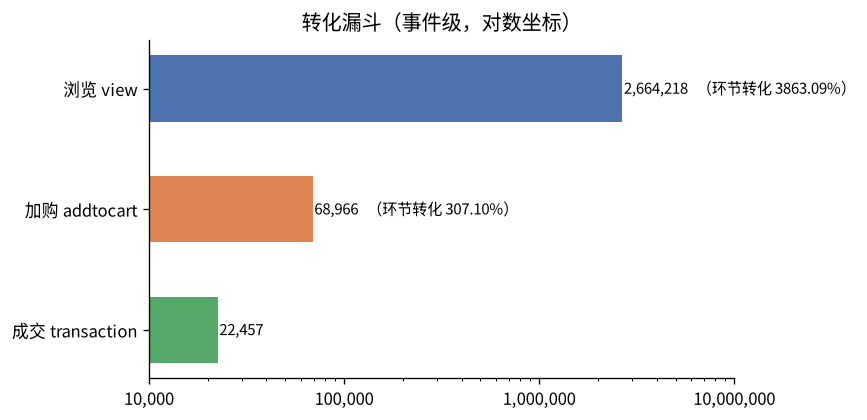
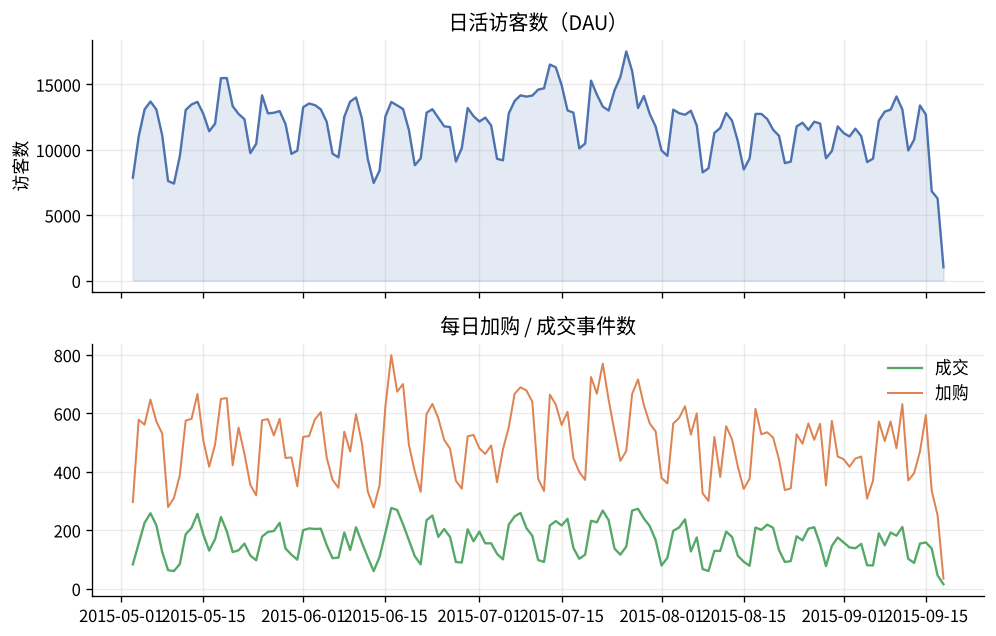
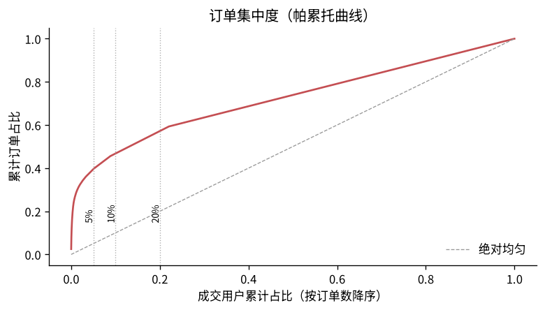

# 📊 电商用户行为分析 · E-commerce User Behavior Analysis

基于 Retailrocket 真实行为日志，做**转化漏斗**、**时间趋势**、**RFM 分层**与 **K-Means 聚类**，
并做**订单集中度**分析。

| 指标 | 数值 |
|---|---|
| 原始事件 | 2,756,101 条 |
| 去重后 | 2,755,641 条（重复 460 条） |
| 独立访客 | 1,407,580 |
| 独立商品 | 235,061 |
| 时间范围 | 2015-05-03 ~ 2015-09-18 |



---

## 📦 数据来源

- **数据集**：Retailrocket recommender system dataset（Kaggle，作者 Roman Zykov）
- **地址**：https://www.kaggle.com/datasets/retailrocket/ecommerce-dataset
- **许可**：CC BY-NC-SA 4.0 —— 需署名、仅限非商业用途、衍生作品相同方式共享
- **使用文件**：`events.csv`（未使用 `item_properties.csv`、`category_tree.csv`）

| 字段 | 含义 |
|---|---|
| timestamp | Unix 毫秒时间戳 |
| visitorid | 访客 ID（已哈希） |
| event | view / addtocart / transaction |
| itemid | 商品 ID（已哈希） |
| transactionid | 订单 ID，仅成交事件有值 |

---

## 一、转化漏斗：事件级 vs 用户级

| 环节 | 事件数 | 事件级环节转化 | 用户数 | 用户级环节转化 |
|---|---|---|---|---|
| 浏览 | 2,664,218 | — | 1,404,179 | — |
| 加购 | 68,966 | 2.59% | 37,722 | 2.69% |
| 成交 | 22,457 | 32.56% | 11,719 | 31.07% |

整体浏览→成交：事件级 **0.84%**，用户级 **0.83%**。

**两种口径几乎一致**，说明同一用户在同一环节平均只产生约 1 个事件，
结论稳健：**瓶颈在「浏览 → 加购」（约 2.6%）**，加购→成交（约 32%）属正常水平。
优化重点应放在商品详情页说服力与推荐精准度，而不是支付环节。

---

## 二、时间趋势



- 日均活跃访客 11,867 人，峰值 17,516（2015-07-26）
- 日均成交 162 笔，峰值 276 笔（2015-06-16）

---

## 三、RFM 分层

以 11,719 名成交用户为对象，R、F 各按四分位打分（4→1）：

| 分层 | 人数 | 占比 |
|---|---|---|
| 高价值 | 2,981 | 25.4% |
| 流失 | 2,963 | 25.3% |
| 潜力 | 2,897 | 24.7% |
| 重要保持 | 2,878 | 24.6% |


> ⚠️ **口径说明**：四分位打分会让四类人数天然接近 25%，这是**打分方法的产物，不是业务结论**。
> 真实的不均衡体现在订单集中度上（见下节）。若要得到有业务意义的阈值，应改用 R/F 原始值或经验阈值切分。

---

## 四、订单集中度：少数人贡献多数订单



| 用户占比（按订单数降序） | 订单占比 |
|---|---|
| 前 1% | 27.8% |
| 前 5% | 39.6% |
| 前 10% | 46.8% |
| 前 20% | 57.2% |

- **78.0% 的成交用户只买过 1 次**，人均订单 1.92 笔
- 典型的长尾结构：头部 10% 用户贡献近一半订单

---

## 五、K-Means 聚类（修正版）

原版直接对原始频率聚类，被极端值带偏（出现“3 个用户的簇”）。本版改进：

1. 频率做 `log1p` 变换，压缩长尾
2. 标准化后用**轮廓系数**与**肘部法**选 k，而非固定 k=4


轮廓系数在 k=7 时最优（0.528），聚类结果：

| 簇 | 人数 | 平均 Recency（天） | 平均 Frequency |
|---|---|---|---|
| 4 | 74 | 62.4 | 75.3 |
| 5 | 284 | 58.0 | 8.4 |
| 1 | 1,056 | 106.4 | 2.4 |
| 2 | 1,162 | 38.6 | 2.4 |
| 0 | 3,367 | 71.8 | 1.0 |
| 3 | 2,893 | 25.0 | 1.0 |
| 6 | 2,883 | 117.3 | 1.0 |

可解释为：**高频大客户（74 人）+ 活跃复购（284 人）+ 普通复购 + 一次性用户按新老分三档**。

---

## 📁 目录结构

```
.
├── README.md
├── requirements.txt
├── download_data.sh
├── data_sample/sample_events.csv
├── 电商用户行为分析.ipynb   # 全部分析（含图表输出）
└── figs/                    # 导出的图表
```

## 🚀 如何运行

```bash
git clone https://github.com/z-Yukai/Analysis-of-E-commerce-User-Behavior.git
cd Analysis-of-E-commerce-User-Behavior
pip install -r requirements.txt
bash download_data.sh          # 自动下载并解压 events.csv 到 data/
jupyter notebook 电商用户行为分析.ipynb
```

说明：

- 数据文件（90MB）不纳入仓库，用脚本按需下载
- 仓库内附 `data_sample/sample_events.csv`（5 万行随机抽样，1.6MB）用于快速跑通流程；
  若没有全量 `data/events.csv`，notebook 会自动回退到样本并在开头提示
- 手动下载：https://www.kaggle.com/datasets/retailrocket/ecommerce-dataset → 解压 `events.csv` 放到 `data/`

---

## ⚠️ 局限

- 原始数据无订单金额（商品属性已哈希），**M（Monetary）维度缺失**，只用 R、F 两维
- 数据为 2015 年单一站点，结论不宜直接外推
- 未剔除爬虫/异常流量（数据集官方任务也提到这类噪声）

## 📈 后续计划

- [ ] 结合 `category_tree.csv` 做品类维度漏斗
- [ ] 加购预测模型（逻辑回归 / LightGBM）
- [ ] 用户生命周期与留存曲线
